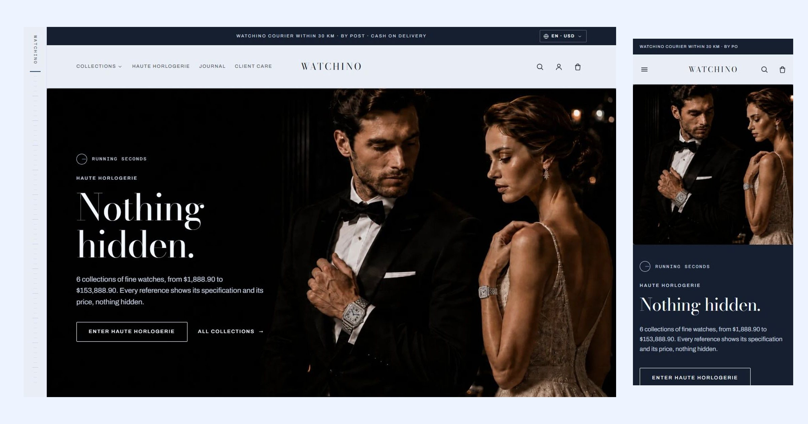
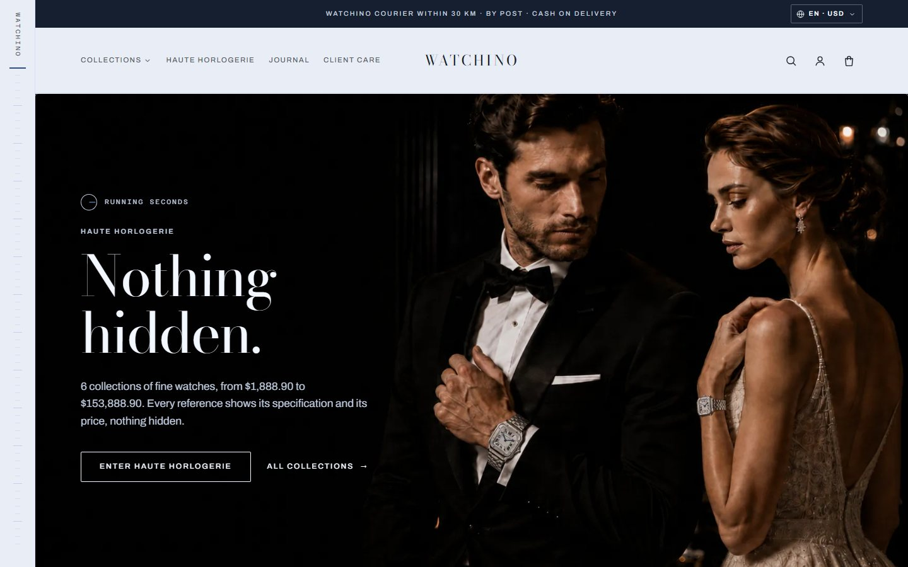
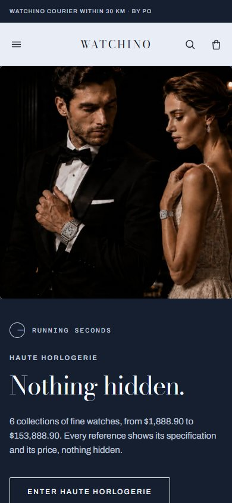
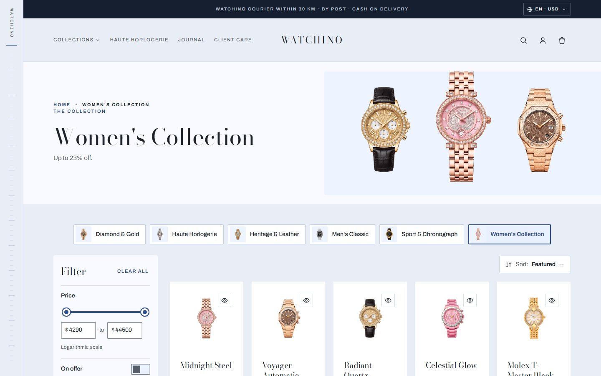
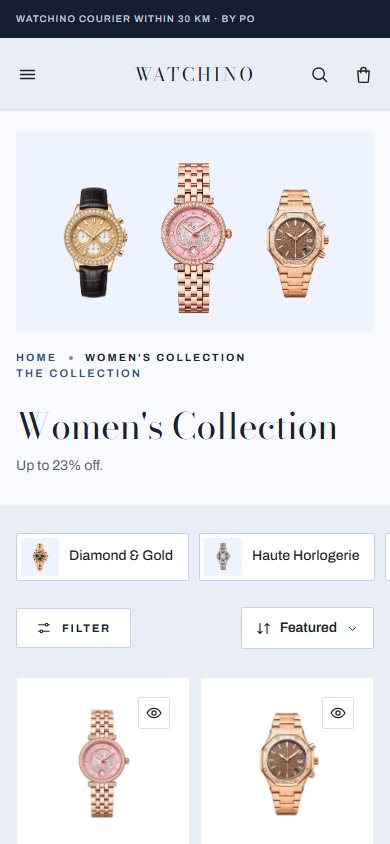
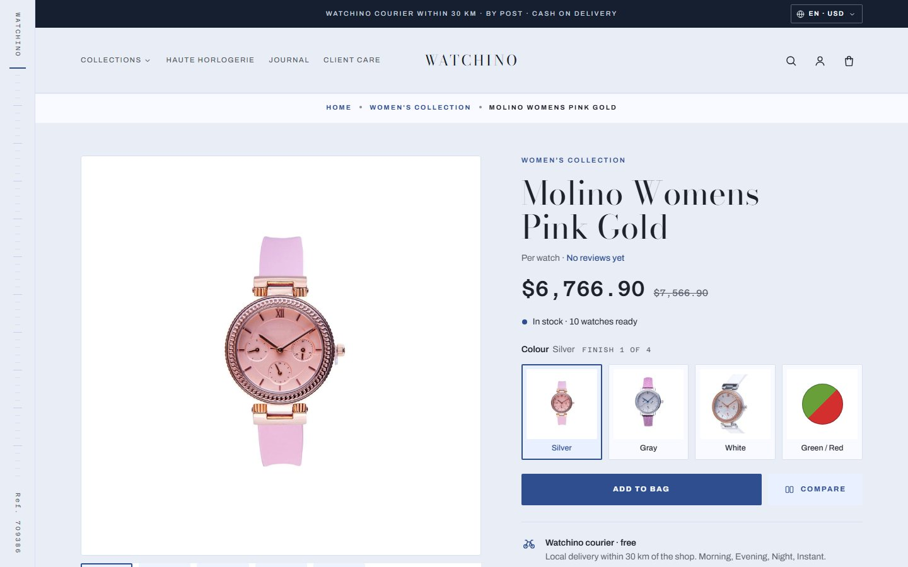
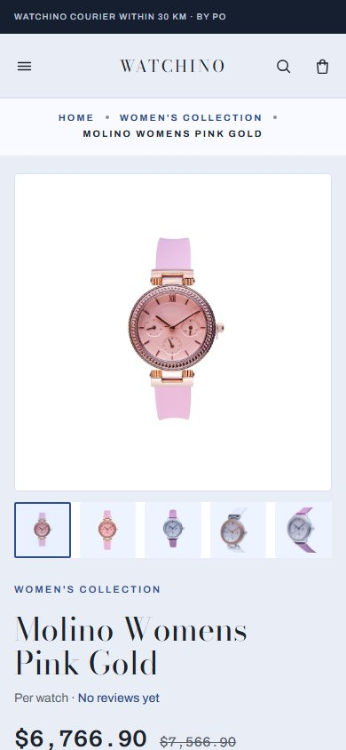
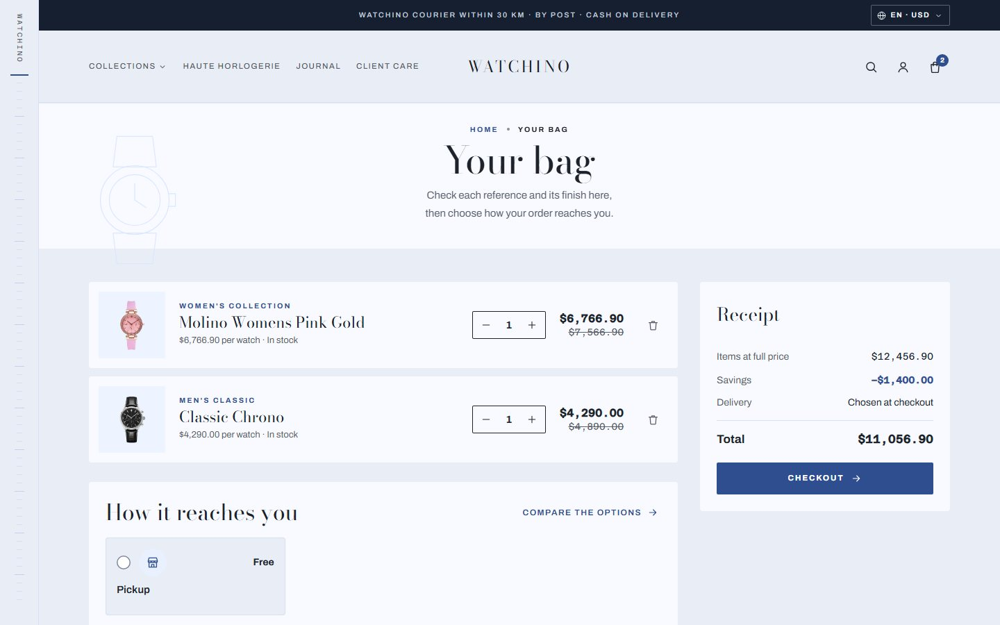
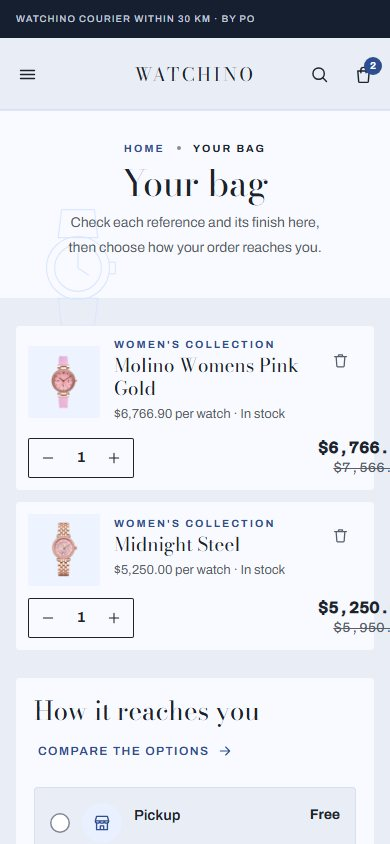

<p align="center">
  
</p>

<h1 align="center">Watchino Fine Watches</h1>

<p align="center">
  <b>Fine watches, nothing hidden.</b><br>
  A custom Selldone Layout built on the official <a href="https://github.com/selldone/storefront">selldone/storefront</a>.
</p>

<p align="center">
  <a href="https://watchino.selldone.shop"></a>
  <a href="https://github.com/selldone-custom-layouts/official-watchino/wiki"></a>
  <a href="https://github.com/selldone-custom-layouts/official-watchino/wiki/Install-with-AI"></a>
  
  
  
</p>

<p align="center">
  <a href="https://watchino.selldone.shop"><b>Open the live shop</b></a> ·
  <a href="https://github.com/selldone-custom-layouts/official-watchino/wiki/Install-with-AI">Set it up with AI</a> ·
  <a href="https://github.com/selldone-custom-layouts/official-watchino/wiki/Manual-Setup">Manual setup</a> ·
  <a href="https://github.com/selldone-custom-layouts/official-watchino/wiki/Shop-Requirements">What your shop needs</a> ·
  <a href="https://github.com/selldone-custom-layouts">All Selldone custom layouts</a>
</p>

---

## What it is

**Watchino Fine Watches** — Fine watches drawn like a dial: a chapter-ring index rail as scroll progress, minute-marker dividers, a photo hero, a hairline grid of collection cut-outs, price registers, a graphite spotlight, a filter column with a logarithmic price track and a sticky product page.

- **one colour family**: the palette's hue gives every ground (the white page, its soft tint bands, the plates, the lines, the words, the dark top bar and footer) and the one action colour (Blued steel `#2f4e8f` by default), so a palette or a custom colour re-tints the whole page;
- Bodoni Moda for headings, the wordmark and numbers set large, over Archivo for reading, buttons and the nav;
- **one shape language**: circles for round things, 4 px panels and photos, 2 px inner parts; square only where a band meets the window's edge; focus rings inside the box, one per control;
- photography in every slot (the shop's own photos, with designed fallbacks drawn from the shop's own products);
- flat buttons, hover changes the colour only, no line under any word or icon;
- light by default, with the other mode in the same family; a **Theme** row in the footer on the showcase shop: Blued steel, Racing green, Burgundy, Bronze, a **Custom colour** and Light / Dark;
- it says **bag**; every word it writes is in English and Arabic (right to left).

It runs on **[watchino.selldone.shop](https://watchino.selldone.shop)**, the shop default of the Selldone shop Watchino; the same shop's [vino.selldone.shop](https://vino.selldone.shop) and [rino.selldone.shop](https://rino.selldone.shop) carry its two other Layouts (Selldone lets each domain of a shop carry its own Layout).

Everything is read live from the shop: its title (drawn as the wordmark), collections, products, prices and savings, delivery ways with their days, fees and time windows, the pickup counter and its hours, the way to pay, the articles. Nothing about Watchino is written in the code, so another shop that imports the Layout gets its own data. Selldone's own bag, checkout, payments and orders keep working underneath.

## The home

| # | Section | Variant | What it shows |
| --- | --- | --- | --- |
| 1 | `wt-home` | `static` | Watchino: the static site's home: photo hero, service strip, the collections as a hairline grid of cut-outs, three price registers, the spotlight, new to the vitrine, how a watch reaches you, client care and the journal. |

A section the shop has no data for hides itself; tint bands alternate with white.

## Screenshots

| Desktop | Phone |
| --- | --- |
|  |  |
|  |  |
|  |  |
|  |  |

Take them from the live shop once it is pinned: `node --use-system-ca scripts/doc-shots.cjs` (through `new-shop-kits/pw-lock.sh`).

## Tests

Every check runs one browser at a time against the shop, at 1440px, 1024px and 390px, dark and light, every palette and the custom colours #ffff00, #00ffff and #111111, and Arabic (right to left). Each is delivered at **TOTAL 0**.

<!-- TESTS:START -->
Not released yet. Before the first upload: `scripts/release.sh` step 5b (the production bundle through the live shop's own HTML). After the pin: the full suite on the live domain (`scripts/run-checks.sh https://watchino.selldone.shop <logs>`, or the fast runner with `scripts/fast-checks.config.mjs`) and the guest checkout walk (`scripts/checkout-walk.mjs`).
<!-- TESTS:END -->

## Photos

| Slot | File | Size | In the build |
| --- | --- | --- | --- |
| hero | `skins/watchino/photos/hero.webp` | 1672 × 941 | yes |
| hero-phone | `skins/watchino/photos/hero-phone.webp` | 900 × 900 | yes |
| story | `skins/watchino/photos/story.webp` | 1600 × 900 | yes |
| boutique | `skins/watchino/photos/boutique.webp` | 1600 × 900 | yes |
| travel | `skins/watchino/photos/travel.webp` | 1600 × 900 | yes |
| gift | `skins/watchino/photos/gift.webp` | 1600 × 900 | yes |
| empty | `skins/watchino/photos/empty.webp` | 1200 × 900 | yes |
| each collection | `skins/watchino/photos/col-<slug of its title>.webp` | 900 × 1200 | 0 file(s); a collection without one shows its best sellers on a plate |

## Use it on your shop

| You want to… | Read |
| --- | --- |
| Let an AI agent (Claude Code, Codex…) set it up for your shop | [Install with AI](https://github.com/selldone-custom-layouts/official-watchino/wiki/Install-with-AI) |
| Do it yourself, step by step | [Manual Setup](https://github.com/selldone-custom-layouts/official-watchino/wiki/Manual-Setup) |
| Know what data your shop needs for the design to look right | [Shop Requirements](https://github.com/selldone-custom-layouts/official-watchino/wiki/Shop-Requirements) |
| Build, upload and verify a release | [Build and Upload](https://github.com/selldone-custom-layouts/official-watchino/wiki/Build-and-Upload) |
| Put the Layout live on your shop, or on one domain of it | [Go Live](https://github.com/selldone-custom-layouts/official-watchino/wiki/Go-Live) |
| Change the name, sections, pages, photos or languages | [Customize](https://github.com/selldone-custom-layouts/official-watchino/wiki/Customize) |
| Change the colours, dark or light, the visitor switcher | [Theme and colours](https://github.com/selldone-custom-layouts/official-watchino/wiki/Theme-and-colours) |
| Fix a blank page, a rejected upload or an old version showing | [Troubleshooting](https://github.com/selldone-custom-layouts/official-watchino/wiki/Troubleshooting) |

## Quick start (developers)

```bash
git clone https://github.com/selldone-custom-layouts/official-watchino.git
cd official-watchino
npm run setup            # the six Selldone modules (modules/)
for p in components translate; do git -C modules/$p apply ../../patches/modules-$p.kalio.patch; done
npm install --force
npm run serve            # dev server on http://localhost:9175, reading the shop named in .env
```

The skin is `skins/watchino/skin.json` (names, palettes, fonts, radius, wordmark, basket word, home sections, photo slots, loading screen) with its photos in `skins/watchino/photos/`; after a change run `node scripts/skin-apply.mjs`. Releases:

```bash
LAYOUT_ID=<your Layout id> SELLDONE_CLI_SRC=<cli clone> bash scripts/release.sh <new version> desk
```

Leave `LAYOUT_ID` out on the first upload; use the id printed after it from then on. Never reuse a version number. Keep the build at 300 files or fewer (the release script prints the count).

## Where things are

| Area | Files |
| --- | --- |
| The skin (the only file that makes this Layout this Layout) | [`skins/watchino/skin.json`](skins/watchino/skin.json), photos in `skins/watchino/photos/` |
| Generated from the skin (never edit) | `components/ly/skin.gen.ts`, `style/ly-skin.gen.scss`, `manifest.json`, `selldone-layout.json`, `.env`, `scripts/loading/config.json`, `checks/` |
| Your theme (palette, brand colour, mode, switcher) | [`components/ly/ly-theme.settings.ts`](components/ly/ly-theme.settings.ts) |
| The colour family | [`components/ly/ly-family-core.ts`](components/ly/ly-family-core.ts) (maths), [`ly-family.ts`](components/ly/ly-family.ts) (painting) |
| The look | [`style/ly/`](style/ly/) (`base.css`, `pages.css`, `look.css`, `variants.css`), [`style/ly-layout.scss`](style/ly-layout.scss), [`style/ly-sd.scss`](style/ly-sd.scss) |
| Header, bag drawer, footer, splash | [`components/ly/shell/`](components/ly/shell/) |
| Home and its sections | [`components/ly/home/`](components/ly/home/) (`LyHome.vue`, `sections.json`, `sections/`) |
| Words (English and Arabic) | [`components/kalio/i18n/ly.en.ts`](components/kalio/i18n/ly.en.ts), [`ly.ar.ts`](components/kalio/i18n/ly.ar.ts); the skin's own words in `skin.json` "words" |
| Release notes, Layout id, checks of each version | [`LAYOUT.md`](LAYOUT.md) |
| The base this Layout is a skin of | [`BASE.md`](BASE.md) |
| Checks and release tooling | [`scripts/`](scripts/) (`run-checks.sh`, `fast-checks.config.mjs`, `release.sh`, `prod-check.mjs`, `checkout-walk.mjs`, `publish-github.sh`) |
| Selldone storefront's original README | [`README.selldone.md`](README.selldone.md) |

## Credits and license

Built on the official [Selldone Storefront](https://github.com/selldone/storefront) (MIT License, © Selldone); see [`LICENSE.md`](LICENSE.md). hero.webp is the shop's own photo; the other photos were generated with Magnific (Freepik) for Watchino under the owner's plan. Part of **[Selldone Custom Layouts](https://github.com/selldone-custom-layouts)**.
